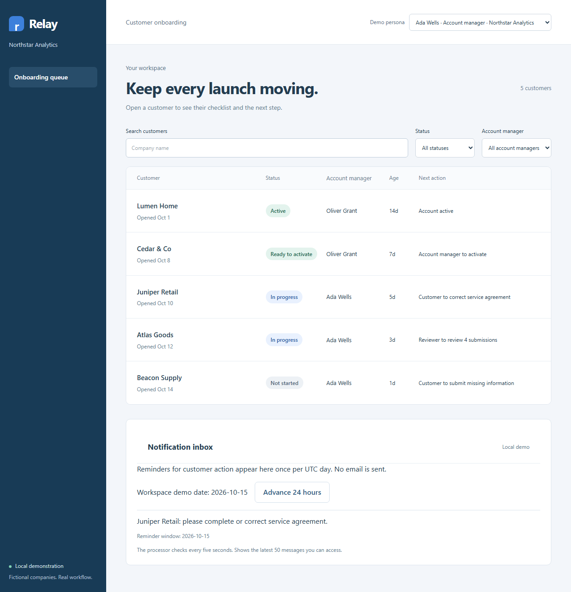

# Relay customer onboarding

Relay helps an account manager take a newly signed retailer from missing
information to an active account. Customers submit a four-item checklist;
reviewers explain corrections; account managers see who needs to act next.



[Watch the 90-second English walkthrough](docs/media/walkthrough.mp4) ·
[Transcript and screenshots](docs/WALKTHROUGH.md) ·
[Engineering case study](docs/CASE_STUDY.md)

## What works

The employee queue supports status, owner, and company filters. The customer
portal collects company details, a PDF agreement, a CSV import, and a launch
contact. Replacements create immutable revisions and require fresh review.
Earlier documents, decisions, correction reasons, and actors remain visible.

Activation requires every mandatory current revision to be approved. Active
accounts reject edits until an account manager explicitly reopens onboarding
with a reason. Server-side sessions scope employees to their provider workspace
and customers to assigned accounts, including historical file downloads.

A durable PostgreSQL outbox delivers customer-action reminders to a local inbox.
Each onboarding receives at most one reminder per UTC day. A persistent workspace
demo clock makes the next window observable without waiting or expiring sessions.

## Run it locally

Use Node **24.20.0**, pnpm **11.23.0**, and Docker with Compose. Windows uses Docker
Engine in WSL Ubuntu; Linux uses its native Docker CLI.

```sh
pnpm install --frozen-lockfile
pnpm env:doctor
pnpm dev
```

Open the reported URL, normally `http://127.0.0.1:4310`. Choose **Ada Wells** for
the queue or **Maya Chen** for Juniper Retail. Juniper's agreement needs correction:
upload `fixtures/service-agreement.pdf` as Maya, approve it as **Noah Ellis**,
then activate it as Ada. The other three requirements are already approved.
The fixtures also cover Beacon (not started), Atlas (waiting for review), Cedar
(ready), and Lumen (active).

**Owen Reed** belongs to Beacon; **Iris Park** belongs to a second provider.
Neither can retrieve Juniper's records. Ada can advance Northstar's demo date in
the inbox to generate another reminder while Juniper still needs customer action.
The processor checks every five seconds; no real email is sent.

## Verify, reset, and stop

```sh
pnpm browser:install
pnpm verify
pnpm env:clean
pnpm env:status
```

Verification creates separate database, storage, and ports; applies migrations and
fixtures; runs lint, strict types, 20 PostgreSQL/API tests, builds, and two Chromium
journeys; then removes its services. CI runs the same command on Linux. Failed
browser checks retain bounded diagnostics. Browser installation is reused under
`.local/browsers/`.

Every development session starts with fresh disposable data. In a second
terminal, `pnpm demo:reset` verifies the recorded process and database identity
before recreating that stack. It becomes the new foreground session.
`env:clean` stops the demo gracefully and recovers recorded leftovers after a
forced stop. Follow the [development guide](docs/DEVELOPMENT.md) for ownership,
ports, migrations, and diagnostics.

## Design and limits

React, Vite, Tailwind, TanStack Query, Fastify, ArkType, Drizzle, and PostgreSQL
form one small application. Dependencies and the database image digest are pinned.

All people, companies, files, dates, and activity are synthetic. The persona picker
is local demo authentication. PDF/CSV uploads are private and limited to 2 MiB;
malware scanning, real identity, external email, and public hosting are outside
this demo. Local verification establishes these scenarios; it provides no
customer adoption or business-impact evidence.

See [measured results](docs/EVIDENCE.md), [delivery PRs](docs/DELIVERY.md), and the
[completed plan](PLAN.md).
