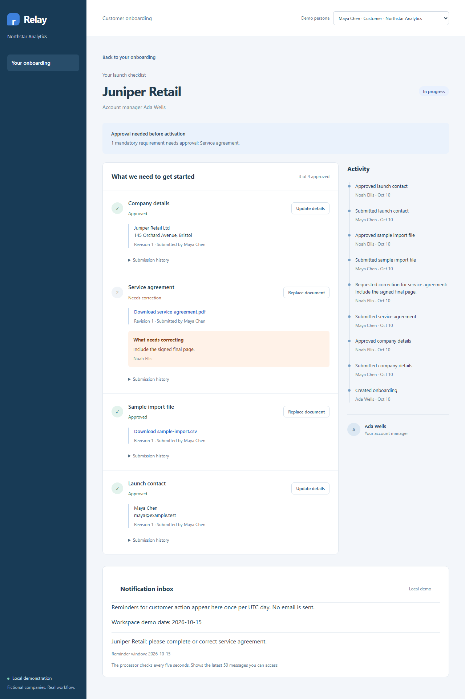
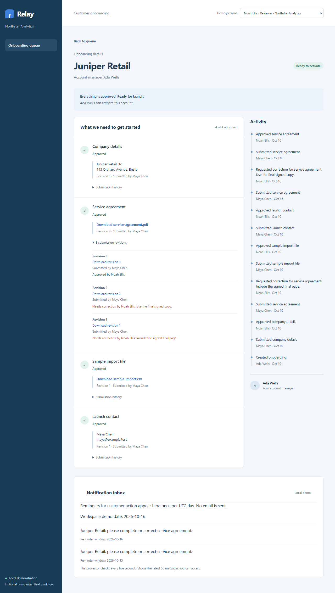

# Relay walkthrough

[Play the English walkthrough](media/walkthrough.mp4) · [WebVTT captions](media/walkthrough.vtt)

Recorded on 2026-10-20 against application commit `b716baa`, with a fresh local
synthetic dataset. The 90.44-second MP4 contains actual browser interaction at
1280×800 and synthetic English narration using Microsoft David Desktop. The
captions and transcript contain the same narration.

## Transcript

**00:00 — Employee queue.** Relay takes a business customer from missing information
to activation. This employee queue shows the owner, age, status, and next action.
All companies and people in this local demonstration are fictional.

**00:10 — Customer checklist.** Juniper Retail is blocked by a service agreement
correction. Switching to Maya opens only her customer's checklist. The reviewer's
explanation is visible beside the document, and earlier submissions remain available.

**00:21 — Reminders.** The local notification inbox uses a durable database outbox.
Advancing the workspace's demo date creates one reminder per UTC day. Restart and
concurrency tests check duplicate prevention. No real email is sent.

**00:33 — Replacement.** Maya uploads a replacement PDF. The server creates a new
revision and returns it to review. An earlier approval cannot silently approve a
replacement. Documents stay behind an authorized download route.

**00:44 — Correction.** As reviewer, Noah requests another correction with a
specific reason. Maya sees that explanation and submits the final copy. The history
preserves both decisions rather than overwriting the first submission.

**00:55 — Activation.** Noah approves the current revision. Every mandatory
requirement is now approved, so the account becomes ready. Ada, the account manager,
can activate it. The server checks those rules inside a database transaction.

**01:07 — History.** Active accounts reject edits until an account manager explicitly
reopens onboarding with a reason. The activity timeline records who submitted,
reviewed, and activated the account. Older private file revisions remain downloadable.

**01:19 — Denied access.** Owen belongs to Beacon Supply. A direct request for
Juniper's details or agreement returns not found. Employee access also stays inside
the session's provider workspace; hiding a link is not the access boundary.

## Screenshots

The queue starts with five Northstar accounts covering each workflow scenario.

Maya sees Juniper's checklist and a specific correction reason.

After two corrections, the reviewer can inspect all three agreement revisions.

